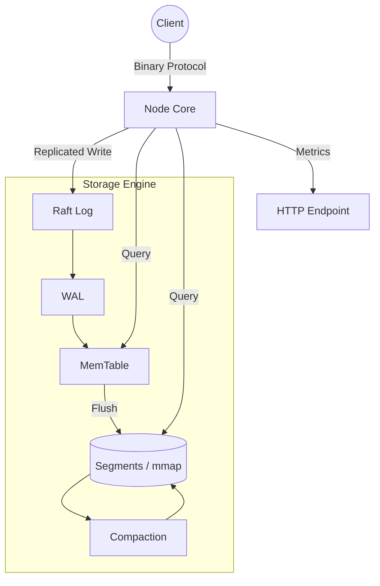

# Lattice

**Tech Stack:** Rust, tokio, tikv/raft-rs, memmap2

A distributed time-series engine built in Rust, alongside an in-memory HNSW vector index. It stores points in compressed memory-mapped segments behind an LSM write path and replicates writes across a Raft cluster. Compression and consensus run in-process, with no external services in the data path.

## Key Features

* **Memory-Mapped Segment Storage:** Points are written to a WAL, buffered in an in-memory MemTable, and flushed to immutable memory-mapped segments. A manifest tracks live segments, and compaction merges them once enough accumulate.
* **Gorilla Compression:** Segments encode timestamps with delta-of-delta and float values with XOR bit-packing, following the Gorilla scheme.
* **Entropy-Coding Library:** `lattice-codec` is a standalone, zero-dependency rANS coder with a self-describing container format, built and tested independently of the engine.
* **Custom Binary Protocol:** Nodes and clients speak a tagged wire protocol over tokio with length-delimited framing; HTTP is not used in the data path.
* **Raft Replication:** Writes route through a Raft log (tikv/raft-rs) and apply to every replica's storage on commit, with leader election over the same transport. An empty peer list runs the node standalone.
* **Vector Search:** An HNSW graph index for approximate nearest-neighbor search, with optional product quantization that compresses vectors to one byte per subspace and scores them by asymmetric distance. Built and benchmarked as a standalone index.
* **Observability:** An HTTP endpoint exposes health, engine statistics, and Prometheus-format metrics.

## System Architecture

Nodes communicate over TCP using the binary protocol. With peers configured, writes are ordered and replicated through Raft before being applied on each node; range queries are served locally.



## Durability and Consistency

* **Write durability:** Each write appends to the WAL and flushes to the OS. This survives a process crash but not a power loss; there is no per-write `fsync`.
* **Cluster acknowledgment:** In a cluster the leader acknowledges a write once it accepts the entry into the Raft log, not after the entry commits and replicates. `ok=true` means accepted, not yet durably committed.
* **Query consistency:** Reads are served from one node's local memtable and segments under a single storage mutex. Queries are not linearized across the cluster, and the lock serializes reads against writes.

## Getting Started

### Prerequisites
* A stable Rust toolchain (pinned in `rust-toolchain.toml`)
* Cargo

### Build and Test
Compile the workspace and run the full test suite:
```bash
cargo build --release
cargo test
```
The codec is independent and verifiable on its own:
```bash
cargo test -p lattice-codec
```

## Usage

### Single Node

1. Start a node. It reads `lattice.toml`, or a config path passed as the first argument, and serves data on port `7700` and HTTP on port `7800`.
```bash
cargo run --release --bin lattice_server
```

2. In a second terminal, connect the CLI to the node's data port. Series are identified by integer id; timestamps and values are numeric.
```bash
cargo run --release --bin lattice_cli -- 127.0.0.1:7700
```
```text
lattice cli -> 127.0.0.1:7700
commands: write <series> <ts> <value> | query <series> <start> <end> | ping | exit
lattice> write 1 1700000000 21.5
ack ok=true
lattice> query 1 0 1700000001
1 points
  1700000000  21.5
lattice> ping
pong
lattice> exit
```

### Cluster

1. Create one config file per node. Each needs a distinct `node_id`, `listen_addr`, `api_addr`, and `data_dir`, and an identical `peers` list naming every node including itself:
```toml
# n1.toml
node_id = 1
data_dir = "./data1"
listen_addr = "127.0.0.1:7700"
api_addr = "127.0.0.1:7800"
[[peers]]
id = 1
addr = "127.0.0.1:7700"
[[peers]]
id = 2
addr = "127.0.0.1:7701"
[[peers]]
id = 3
addr = "127.0.0.1:7702"
```
`n2.toml` and `n3.toml` differ only in `node_id` (2, 3), `data_dir` (`./data2`, `./data3`), and the two addresses (ports `7701`/`7801` and `7702`/`7802`).

2. Start each node in its own terminal:
```bash
cargo run --release --bin lattice_server -- n1.toml
cargo run --release --bin lattice_server -- n2.toml
cargo run --release --bin lattice_server -- n3.toml
```
The nodes elect a leader within a few seconds.

3. Writes are accepted only by the leader; a write to a follower returns `ok=false`. Write through the leader, then query a different node to confirm the entry replicated across the cluster:
```text
lattice> write 1 1700000000 21.5
ack ok=true
```
```text
lattice> query 1 0 1700000001
1 points
  1700000000  21.5
```

## Observability

The node serves read-only endpoints over HTTP on `api_addr` (default port 7800):
```text
GET /health    liveness
GET /stats     engine statistics (series, segments, memtable points)
GET /metrics   Prometheus-format metrics
```

## Configuration

Runtime configuration is read from `lattice.toml`, falling back to defaults when absent.
```text
node_id                node identity and Raft voter id
listen_addr            binary-protocol address (default 0.0.0.0:7700)
api_addr               HTTP endpoint address (default 0.0.0.0:7800)
data_dir               WAL and segment directory
memtable_max_points    in-memory points before a flush
peers                  cluster members as [[peers]] with id and addr; empty = standalone
```

## License

MIT
